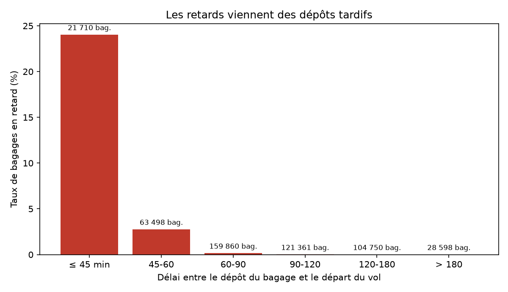
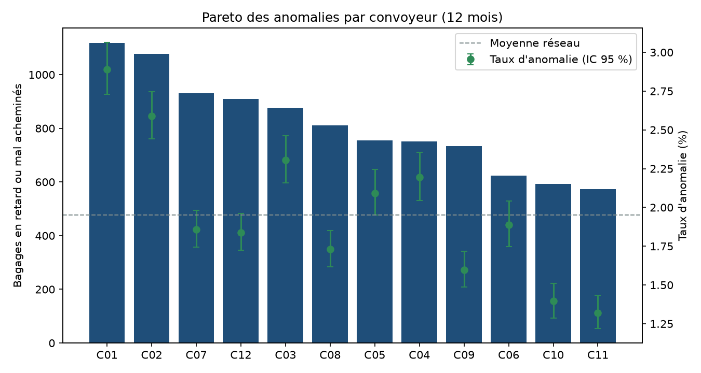
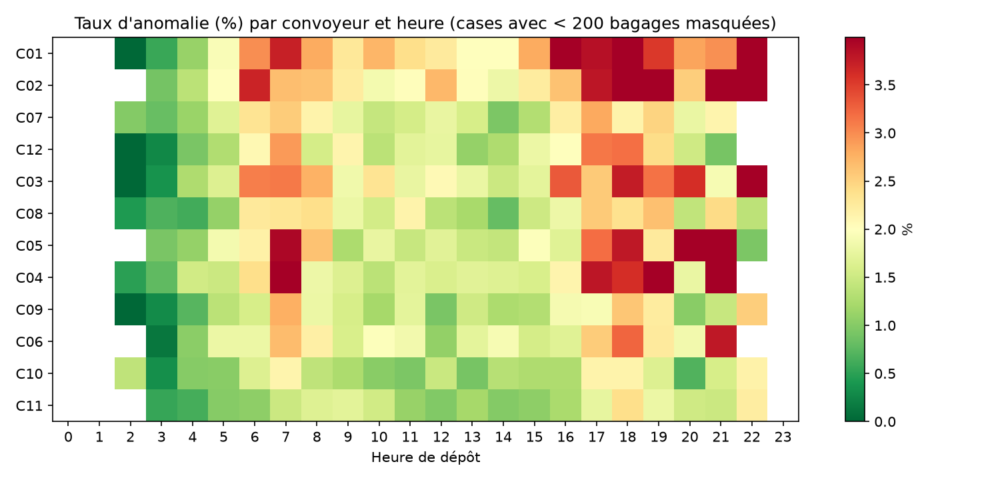
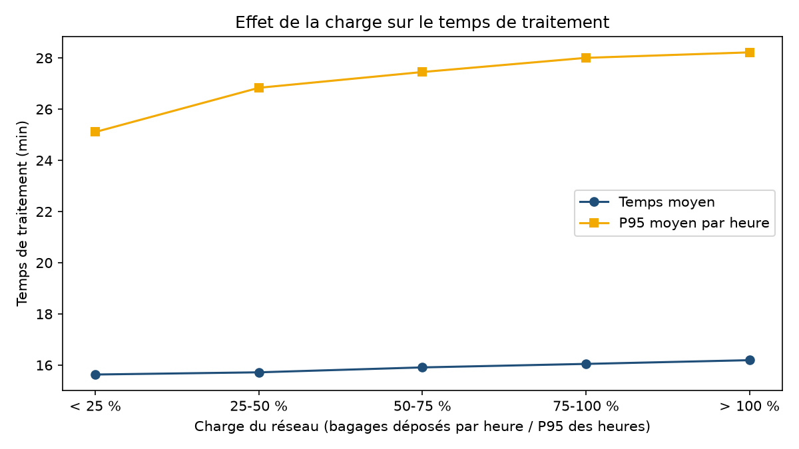
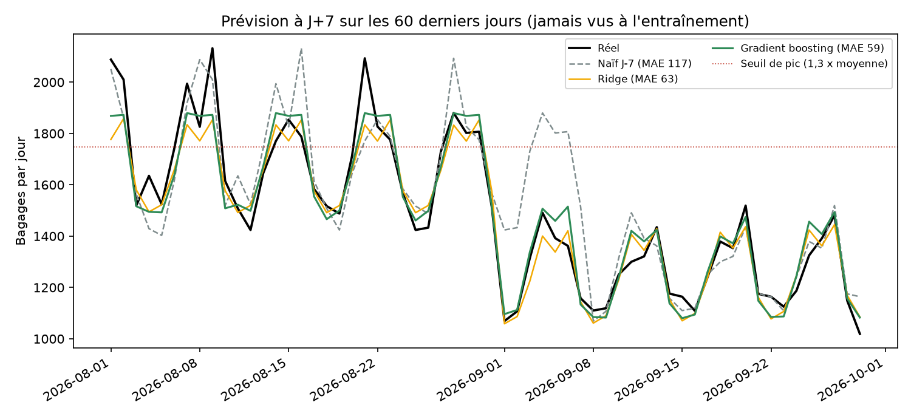
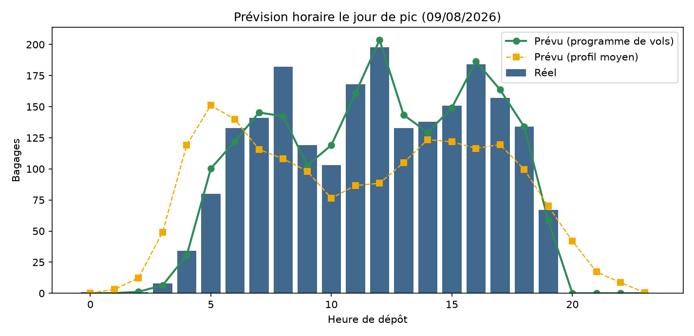
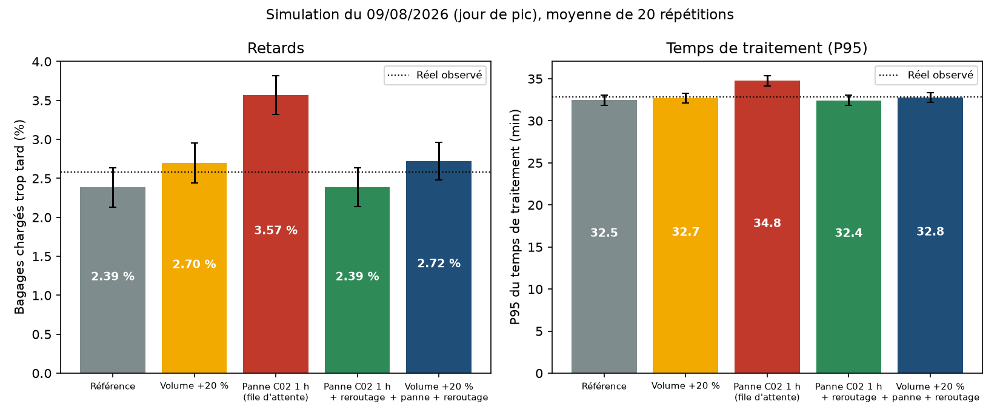
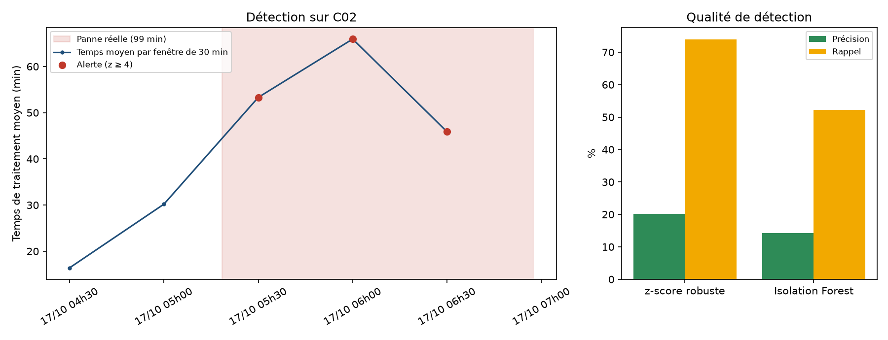

# Goulots d'étranglement, prévision des pics et scénarios « et si ? » (Python)

Suite du projet [bagage-kpi-dashboard](https://github.com/richardfaihoun123-ux/bagage-kpi-dashboard) : à partir des mêmes
données **synthétiques** (500 000 bagages sur 12 mois, 12 convoyeurs, 45 pannes), cette analyse cherche à
**challenger les indicateurs existants** et à identifier des leviers d'amélioration :

1. **Où et pourquoi** les bagages sont-ils en retard ? (analyse des goulots)
2. **Combien de bagages demain, et à quelle heure ?** (prévision à J+7 et par heure)
3. **Que se passe-t-il si** le volume augmente de 20 % ou si un convoyeur tombe en panne ? (simulation)
4. **Peut-on détecter une panne** à partir des seuls temps de traitement ? (détection d'anomalies)

> Toutes les données sont fictives. Les résultats valident une **méthode d'analyse**, ils ne décrivent pas un aéroport réel
> (voir « Limites »).

## Résultats clés

| Question | Résultat |
|---|---|
| Cause des retards | **96,6 % des bagages en retard ont été déposés moins de 60 min avant le départ**, alors qu'ils ne représentent que 17 % des bagages. Taux de retard : 24 % si dépôt ≤ 45 min, 0,15 % si dépôt entre 60 et 90 min |
| Convoyeurs | C01 et C02 portent **22,5 % des anomalies pour 16,0 % des bagages** (taux de 2,9 % et 2,6 % contre 1,3 % et 1,4 % pour C11 et C10) |
| Effet de la charge | Faible sur la moyenne (+0,6 min entre les heures les plus calmes et les plus chargées), plus net sur la queue de distribution : le P95 passe de 25,1 à 28,2 min |
| Prévision à J+7 | Erreur moyenne de **60 bagages/jour** (3,8 %) contre 117 (8,1 %) pour la méthode naïve « même jour la semaine passée » ; 14 jours de pic sur 14 retrouvés sans fausse alerte |
| Prévision horaire | Avec le programme de vols : erreur de **8,7 %** (contre 44 % avec un profil moyen et 65 % en naïf) ; heure de pointe trouvée à ± 1 h dans 87 % des jours |
| Scénarios (jour de pic) | Volume +20 % : retards de 2,4 % à 2,7 %. **Panne de C02 pendant 1 h : 3,6 %** (file jusqu'à 36 bagages). Avec reroutage dans le terminal : 2,4 %, l'impact disparaît |
| Détection de pannes | z-score robuste : 84 alertes/an, précision 20 %, **8 pannes sur 12 détectables retrouvées** ; avec un seuil plus strict, 28 alertes et 57 % de précision |

## 1. Goulots : les retards viennent des dépôts tardifs

Le facteur dominant n'est ni la charge ni un convoyeur en particulier, mais **le délai entre le dépôt du bagage et le départ du vol**.



Parmi les convoyeurs, C01 et C02 (les plus longs) cumulent le plus d'anomalies. Les intervalles de confiance à 95 % montrent
que l'écart avec C10 et C11 n'est pas dû au hasard.



La carte thermique convoyeur x heure localise les créneaux à surveiller (cases avec moins de 200 bagages masquées) :



La charge du réseau allonge faiblement les temps de traitement, surtout en queue de distribution :



## 2. Prévision des volumes

**Quotidienne (J+7).** Modèle entraîné jusqu'au 31/07/2026 et évalué sur les 60 jours suivants, jamais vus. Variables : jour de
la semaine, vacances, saison, volumes à J-7 et J-14, moyenne des 28 jours disponibles à J-7.

| Modèle | Erreur absolue moyenne (bagages/jour) | Erreur relative |
|---|---|---|
| Naïf (même jour S-1) | 117 | 8,1 % |
| Régression Ridge | 63 | 4,0 % |
| **Gradient boosting** | **60** | **3,8 %** |



Point faible : le modèle **sous-estime les plus gros pics** (en moyenne de 9 % sur les 5 jours les plus chargés), car il n'a vu
qu'un seul été.

**Horaire.** Deux approches comparées sur les mêmes 60 jours :

| Approche | Erreur horaire (WAPE) | Erreur sur le volume de l'heure de pointe |
|---|---|---|
| Naïf (même heure S-1) | 64,6 % | 20,7 % |
| Prévision du jour x profil horaire moyen | 44,4 % | 15,3 % |
| **Programme de vols** (chaque vol programmé répartit ses bagages selon la distribution observée des délais de dépôt) | **8,7 %** | **6,5 %** (12 bagages) |



Le profil moyen lisse les vagues de départs ; le programme de vols, connu à l'avance, les reproduit.

## 3. Simulation de scénarios (SimPy)

Chaque convoyeur est un poste d'injection (un serveur, file FIFO) suivi d'un temps de transport. Les paramètres sont calibrés
sur les données (capacité : charge horaire maximale observée x 1,15 ; transport : temps médian en heures calmes). Le simulateur
est recalé sur le jour de pic du 09/08/2026 avant de lancer les scénarios : la référence simulée (2,4 % de retards, P95 de
32,5 min) colle au réel (2,6 %, 32,8 min). Chaque scénario est répété 20 fois.

| Scénario | Bagages chargés trop tard | P95 du temps de traitement | File max |
|---|---|---|---|
| Référence | 2,38 % | 32,5 min | 6 |
| Volume +20 % | 2,70 % | 32,7 min | 13 |
| Panne de C02 (1 h), file d'attente | **3,56 %** | **34,8 min** | **36** |
| Panne de C02 (1 h) + reroutage dans le terminal | 2,37 % | 32,5 min | 6 |
| Volume +20 % + panne + reroutage | 2,72 % | 32,7 min | 13 |



Le réseau absorbe +20 % de volume sans dégrader fortement le service : **la capacité n'est pas le facteur limitant**. Le vrai
risque est une panne sans plan de reroutage.

## 4. Détection d'anomalies, validée contre les pannes réelles

Fenêtres de 30 min par convoyeur ; score : écart robuste (médiane et MAD du log du temps de traitement, par convoyeur et par
heure) normalisé par le nombre de bagages. Les pannes injectées dans les données servent de vérité terrain. Comparaison avec
une Isolation Forest, à nombre d'alertes identique.

| Méthode | Alertes/an | Précision | Rappel (fenêtres) | Pannes détectables retrouvées |
|---|---|---|---|---|
| **z-score robuste (z ≥ 4)** | 84 | 20 % | 74 % | 8 sur 12 |
| Isolation Forest | 84 | 14 % | 52 % | 6 sur 12 |

Le seuil est un choix métier (budget d'alertes) :

| Seuil z | 3 | 4 | 5 | 6 | 8 |
|---|---|---|---|---|---|
| Alertes/an | 328 | 84 | 28 | 17 | 11 |
| Précision | 5 % | 20 % | 57 % | 88 % | 100 % |
| Pannes retrouvées (sur 12) | 8 | 8 | 7 | 6 | 5 |



Seules 12 pannes sur 45 ont assez de bagages pendant leur durée (3 par fenêtre au minimum) pour être évaluables : **les temps de
traitement seuls ne suffisent pas**, il faudrait des capteurs sur les convoyeurs.

## Leviers proposés (hypothèses à tester)

1. **Traiter les dépôts tardifs** : 17 % des bagages expliquent 97 % des retards. Communication, fermeture ou file prioritaire de
   dépôt pour les vols imminents, suivi du taux de dépôts tardifs par compagnie.
2. **Affecter les vols à départ proche aux convoyeurs les plus courts** : C01 et C02 ont les temps de transport les plus longs
   (P95 de 32,5 et 31,3 min contre 24,6 min pour C10 et C11).
3. **Formaliser un plan de reroutage en cas de panne** : en simulation, il annule l'impact d'une panne d'une heure ; à vérifier
   avec la capacité réellement disponible.
4. **Dimensionner les équipes avec le programme de vols** et une alerte quand la prévision dépasse 1,3 fois la moyenne.
5. **Alertes de dérive** : z-score ≥ 5 pour limiter les fausses alertes, complété par des capteurs.

## Limites

- **Données synthétiques, mécanismes connus** : l'effet du délai de dépôt et de la longueur des convoyeurs a été défini dans le
  générateur du projet 1. L'analyse montre qu'elle **retrouve et quantifie** ces mécanismes ; ce n'est pas une découverte sur un
  aéroport réel.
- **Un an de données** : pas de vraie comparaison N-1, un seul été pour apprendre la saisonnalité (d'où la sous-estimation des pics).
- **Prévision horaire optimiste** : dans la simulation, le nombre de bagages par vol varie peu ; en réel, il faut le prévoir
  (réservations, taux de remplissage).
- **Simulation simplifiée** : un serveur par convoyeur, reroutage instantané, pas de mal acheminés modélisés, capacité déduite de
  l'observé.
- **Détection de pannes** : évaluée sur 12 pannes seulement ; seuils à recalibrer sur des données réelles.

## Lancer l'analyse

```bash
pip install -r requirements.txt
# copier ici le dossier data/csv généré par le projet 1 (python generate_data.py)
python src/run_analysis.py --data data/csv
```
Durée : environ une minute. Sorties : `results/figures/*.png` et `results/summary.json`. Les chiffres peuvent varier légèrement
selon les versions des bibliothèques.

## Structure

```
src/data.py          chargement des CSV du projet 1
src/bottlenecks.py   Pareto, délai de dépôt, charge, carte thermique
src/forecast.py      prévision quotidienne (J+7) et horaire
src/simulation.py    simulation SimPy et scénarios
src/anomalies.py     détection d'anomalies et validation
src/run_analysis.py  lance tout
results/             figures et summary.json
```
